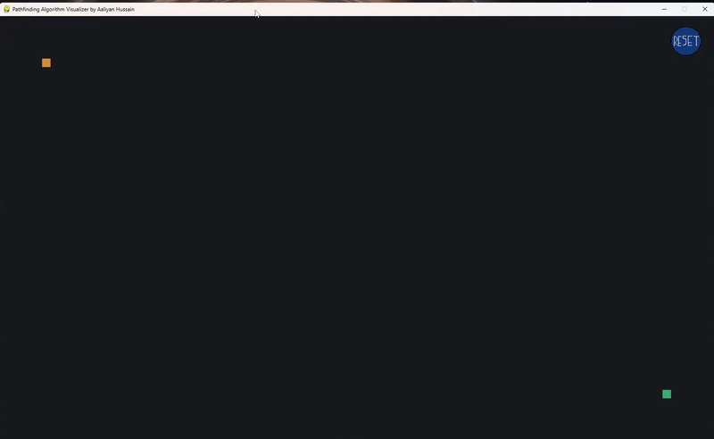
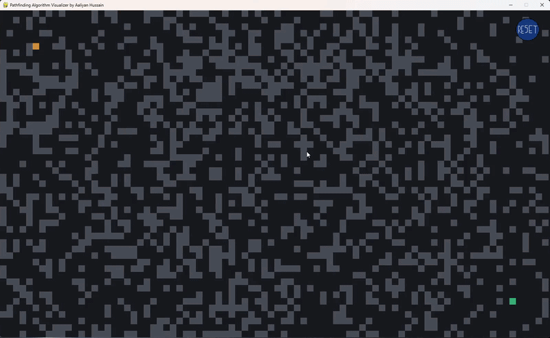

A* Pathfinding Algorithm Visualizer

A clean, interactive Python application built with Pygame that visualizes the A* Pathfinding Algorithm* in real-time. Designed to demonstrate core computer science search logic, heuristic calculations, and interactive grid-based data structures.

---

🚀 Features

* Interactive Grid Creation:** Click and drag to draw custom barriers, walls, and obstacles across the map.
* A* Search Algorithm: Implements heuristic-driven shortest-path calculation utilizing "Manhattan Distance".
* Visual State Rendering: Real-time color-coded tracking of visited nodes, evaluated paths, and the final optimal route.
* Instant Reset: Quick-clear functionality to test multiple maze configurations back-to-back.

---

🎬 Visual Demos

1. Custom Barrier & Maze Construction
Easily paint custom walls and obstacles across the grid layout:


---

2. A* Pathfinding Execution
Watch the algorithm compute and trace the optimal path instantly:


---

🛠️ Built With
* "Python" (Core application logic)
* "Pygame" (Rendering and real-time event handling)

---

💻 Getting Started Locally

Prerequisites
Make sure you have Python installed, along with the Pygame library:
```bash
pip install pygame
